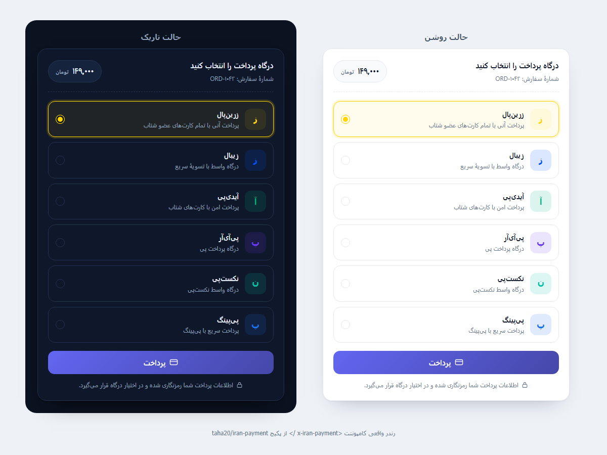

# iran-payment

[](https://github.com/khoshkhu95/iran-payment/actions/workflows/tests.yml)
[](LICENSE.md)

پکیج جامع درگاه‌های پرداخت ایرانی برای لاراول.

- **۱۳ درگاه واقعی** + یک درگاه آزمایشی، همه با یک اینترفیس یکسان
- **سوئیچ بین درگاه‌ها فقط با یک خط config** (یا حتی یک متغیر `.env`)
- **کامپوننت آمادهٔ `<x-iran-payment />`** که لیست درگاه‌های فعال را نشان می‌دهد
- **بدون وابستگی به Tailwind، Vite یا بیلد فرانت‌اند**
- سازگار با **لاراول ۱۰، ۱۱، ۱۲ و ۱۳** / PHP 8.2+



---

## چرا این پکیج

اکثر پروژه‌ها یک درگاه را hard-code می‌کنند و روزی که درگاه قطع شود یا
کارمزدش عوض شود، باید کل کد پرداخت را بازنویسی کنند. این پکیج لایهٔ پرداخت
را از منطق دامنه جدا می‌کند:

```
┌──────────────┐   Payment    ┌──────────────────┐   Driver   ┌──────────┐
│  کد شما      │ ───────────► │  PaymentProcessor │ ─────────► │  درگاه   │
│ (سفارش/اشتراک)│ ◄─────────── │  + Transaction    │ ◄───────── │ (زرین‌پال،│
└──────────────┘   Event      └──────────────────┘   Result   │  زیبال…) │
```

کد شما فقط `Payment` می‌سازد و به رویداد `PaymentSucceeded` گوش می‌دهد.
هیچ‌جا نام درگاه نوشته نمی‌شود.

---

## نصب

### ۱) افزودن پکیج

```bash
composer require taha20/iran-payment
```

یا اگر پکیج را به‌صورت محلی دارید، در `composer.json` پروژه:

```json
"repositories": [
    { "type": "path", "url": "../packages/taha20/iran-payment" }
],
"require": {
    "taha20/iran-payment": "*"
}
```

سپس:

```bash
composer update taha20/iran-payment
```

### ۲) نصب سریع

```bash
php artisan iran-payment:install
```

این دستور فایل config، ویوها و مایگریشن را منتشر و (با تأیید شما) مایگریشن را اجرا می‌کند.

### ۳) تنظیم درگاه

در `.env`:

```dotenv
IRAN_PAYMENT_GATEWAY=zarinpal

ZARINPAL_MERCHANT_ID=xxxxxxxx-xxxx-xxxx-xxxx-xxxxxxxxxxxx
```

همین. حالا کافی است کامپوننت را در هر ویویی بگذارید:

```blade
<x-iran-payment :amount="1490000" order-id="ORD-1042" />
```

> مبلغ به واحد پیش‌فرض پروژه تفسیر می‌شود (پیش‌فرض: ریال). برای تومان،
> `IRAN_PAYMENT_CURRENCY=IRT` را ست کنید یا `unit="IRT"` را روی کامپوننت بدهید.

---

## کامپوننت `<x-iran-payment />`

لیست درگاه‌های فعال را به‌صورت کارت‌های قابل انتخاب نشان می‌دهد و کاربر با
انتخاب هرکدام به صفحهٔ بانک منتقل می‌شود.

```blade
<x-iran-payment
    :amount="1490000"
    order-id="ORD-1042"
    description="خرید اشتراک طلایی"
    :payable="$order"
    return-url="{{ route('orders.show', $order) }}"
    mobile="{{ $order->user->mobile }}"
/>
```

| ویژگی | نوع | توضیح |
|---|---|---|
| `amount` | int | **اجباری** — مبلغ به واحد پیش‌فرض پروژه |
| `order-id` | string | شمارهٔ سفارش؛ اگر ندهید از کلید `payable` یا یک شناسهٔ تصادفی ساخته می‌شود |
| `description` | string | توضیحی که در صفحهٔ بانک و پنل درگاه دیده می‌شود |
| `payable` | Model | اتصال morph به مدل دامنه (سفارش، اشتراک، …) |
| `return-url` | string | آدرس بازگشت پس از پرداخت |
| `gateway` | string | درگاه پیش‌انتخاب‌شده |
| `mobile` / `email` | string | برای پیش‌فرض‌های درگاه (مثل زرین‌پال) |
| `unit` | `IRR` \| `IRT` | واحد مبلغ همین کامپوننت |
| `only` | array | فقط این درگاه‌ها نمایش داده شوند |
| `exclude` | array | این درگاه‌ها نمایش داده نشوند |
| `layout` | `grid` \| `list` | چیدمان کارت‌ها |
| `theme` | `auto` \| `light` \| `dark` | تم |
| `button-label` | string | متن دکمه |
| `show-amount` | bool | نمایش/عدم نمایش مبلغ |

### امنیت مبلغ

مبلغ و شمارهٔ سفارش **هرگز** به‌صورت خام در HTML قرار نمی‌گیرند. کامپوننت
آن‌ها را با `APP_KEY` پروژه رمزنگاری می‌کند و سرور فقط توکن معتبر را می‌پذیرد.
اگر کاربر مبلغ را در DevTools عوض کند، درخواست رد می‌شود.

---

## استفادهٔ برنامه‌نویسی

```php
use Taha20\IranPayment\Facades\IranPayment;
use Taha20\IranPayment\Support\Payment;

$payment = Payment::make(1490000, 'ORD-1042')
    ->withDescription('خرید اشتراک طلایی')
    ->withMobile('09120000000')
    ->withReturnUrl(route('orders.show', $order))
    ->for($order);            // اتصال به مدل دامنه

$response = IranPayment::pay($payment, 'zibal');

return match ($response->type) {
    'redirect' => redirect()->away($response->url),
    'form'     => view('iran-payment::redirect', [
        'action' => $response->formAction,
        'data'   => $response->formData,
    ]),
};
```

### تغییر درگاه در زمان اجرا

```php
IranPayment::use('idpay')->pay($payment);   // این درخواست با آیدی‌پی
```

### بازگشت وجه

```php
$result = IranPayment::refund($transaction);

if ($result->success) {
    // ...
}
```

---

## رویدادها

| رویداد | زمان |
|---|---|
| `PaymentInitiated` | تراکنش در درگاه ساخته شد (قبل از رفتن کاربر به بانک) |
| `PaymentSucceeded` | پرداخت تأیید شد |
| `PaymentFailed` | پرداخت ناموفق/لغو/خطای ارتباط |
| `PaymentRefunded` | بازگشت وجه انجام شد |

نمونهٔ Listener:

```php
use Taha20\IranPayment\Events\PaymentSucceeded;

class MarkOrderAsPaid
{
    public function handle(PaymentSucceeded $event): void
    {
        $event->transaction->payable?->markAsPaid();

        // $event->transaction->tracking_code
        // $event->transaction->card_number
    }
}
```

ثبت در `AppServiceProvider`:

```php
Event::listen(PaymentSucceeded::class, MarkOrderAsPaid::class);
```

---

## درگاه‌های پشتیبانی‌شده

| کلید | درگاه | نوع | نوع اتصال |
|---|---|---|---|
| `zarinpal` | زرین‌پال | واسط | REST v4 |
| `zibal` | زیبال | واسط | REST v1 |
| `idpay` | آیدی‌پی | واسط | REST v1.1 |
| `payir` | پی‌آی‌آر | واسط | REST |
| `nextpay` | نکست‌پی | واسط | REST |
| `payping` | پی‌پینگ | واسط | REST v2 |
| `aqayepardakht` | آقای پرداخت | واسط | REST v2 (تومان) |
| `paystar` | پی‌استار | واسط | REST |
| `mellat` | به‌پرداخت ملت | مستقیم | SOAP |
| `sadad` | سداد (بانک ملی) | مستقیم | REST + امضای RSA |
| `saman` | سامان (سپ) | مستقیم | REST + SOAP |
| `parsian` | پارسیان | مستقیم | SOAP |
| `pasargad` | پاسارگاد | مستقیم | RSA |
| `fake` | درگاه آزمایشی | — | محلی |

> درگاه‌های بانکی مستقیم به کلید/ترمینال واقعی نیاز دارند. قبل از استفادهٔ
> عملیاتی، یک تراکنش واقعی در محیط تست بانک انجام دهید؛ برخی بانک‌ها
> پارامترهای اضافی (مثل `AdditionalData`) را متفاوت تفسیر می‌کنند و
> می‌توانید آن‌ها را از config همان درگاه تنظیم کنید.

---

## افزودن درگاه سفارشی

فقط یک کلاس و یک آیتم config:

```php
namespace App\Payments;

use Taha20\IranPayment\Gateways\AbstractGateway;
use Taha20\IranPayment\Models\Transaction;
use Taha20\IranPayment\Support\PaymentResponse;
use Taha20\IranPayment\Support\VerificationResult;

class MyGateway extends AbstractGateway
{
    public function purchase(Transaction $transaction): PaymentResponse
    {
        $response = $this->postJson('https://api.example.com/pay', [
            'amount'      => $transaction->amount,
            'callback'    => $this->callbackUrl($transaction),
            'order_id'    => $transaction->order_id,
            'merchant_id' => $this->require('merchant_id'),
        ]);

        return PaymentResponse::redirect($response['url'], $response['token'], $response);
    }

    public function verify(Transaction $transaction, array $callback): VerificationResult
    {
        $response = $this->postJson('https://api.example.com/verify', [
            'token' => $transaction->reference,
        ]);

        return ($response['ok'] ?? false)
            ? VerificationResult::success(referenceId: $response['ref_id'], raw: $response)
            : VerificationResult::failure($response['message'] ?? null, $response);
    }
}
```

```php
// config/iran-payment.php
'my-gateway' => [
    'driver' => App\Payments\MyGateway::class,
    'enabled' => true,
    'title' => 'درگاه من',
    'description' => 'توضیح کوتاه',
    'color' => '#0ea5e9',
    'merchant_id' => env('MY_GATEWAY_MERCHANT_ID'),
],
```

همین. کامپوننت خودش آن را نشان می‌دهد و `IranPayment::use('my-gateway')` کار می‌کند.

اگر نمی‌خواهید کلاس جدا بسازید:

```php
IranPayment::manager()->extend('dynamic', fn () => new MyGateway([...]));
```

---

## تست

```php
use Taha20\IranPayment\Facades\IranPayment;

IranPayment::fake();          // پرداخت موفق
IranPayment::fake('failed');  // پرداخت ناموفق

$this->post(route('iran-payment.pay'), ['token' => $token, 'gateway' => 'fake']);
```

برای تست‌های بدون دیتابیس:

```dotenv
IRAN_PAYMENT_DB_ENABLED=false
```

---

## تنظیمات مهم

| کلید | پیش‌فرض | توضیح |
|---|---|---|
| `default` | `zarinpal` | درگاه پیش‌فرض |
| `currency` | `IRR` | واحد ورودی مبالغ |
| `routes.enabled` | `true` | اگر `false`، خودتان روت/کنترلر می‌سازید |
| `routes.prefix` | `iran-payment` | پیشوند آدرس‌ها |
| `transactions.enabled` | `true` | ذخیره در دیتابیس؛ `false` = حالت بی‌حالت |
| `security.sign_payments` | `true` | امضای توکن مبلغ |
| `http.retry` | `0` | تکرار خودکار درخواست — برای پرداخت عمداً صفر |
| `ui.only` / `ui.except` | `[]` | محدود کردن لیست نمایشی درگاه‌ها |

---

## ساختار تراکنش

هر پرداخت یک رکورد در جدول `iran_payments` می‌سازد:

```php
$transaction->amount;         // به ریال
$transaction->formattedAmount(); // ۱۴۹,۰۰۰ تومان
$transaction->status;         // TransactionStatus enum
$transaction->tracking_code;  // کد رهگیری
$transaction->card_number;    // شمارهٔ کارت ماسک‌شده
$transaction->payable;        // مدل دامنه
```

برای طراحی کامل و دلایل هر انتخاب، [docs/ARCHITECTURE.md](docs/ARCHITECTURE.md) را ببینید.

---

## مجوز

MIT
